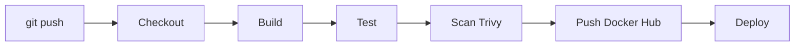

# Pipeline CI/CD DevSecOps pour une API FastAPI

Projet d'apprentissage : automatiser la construction, le test, le scan de sécurité,
la publication et le déploiement d'une API Python avec Docker et Jenkins.

## Objectif

À chaque `git push`, un pipeline construit l'image Docker de l'API, la teste,
recherche les failles de sécurité, la publie sur Docker Hub puis la déploie.
Si le test ou le scan échoue, rien n'est publié ni déployé.

## Architecture du pipeline



| Étape | Rôle |
|---|---|
| Checkout | Récupère le code depuis GitHub |
| Build | Construit l'image Docker |
| Test | Vérifie que l'application se charge sans erreur |
| Scan | Trivy cherche les failles connues (HIGH, CRITICAL) |
| Push | Publie l'image sur Docker Hub |
| Deploy | Lance le conteneur de la nouvelle version |

## Technologies

- **Python / FastAPI** : l'API
- **Docker** et **Docker Compose** : conteneurisation et orchestration
- **Jenkins** (dans un conteneur) : pipeline CI/CD décrit dans un `Jenkinsfile`
- **Trivy** : scan de sécurité des images
- **Docker Hub** : registre d'images
- **Git / GitHub** : versionnement du code

## Structure du projet

```
mon-api/
├── main.py              # Code de l'API
├── requirements.txt     # Dépendances Python
├── Dockerfile           # Recette de l'image
├── docker-compose.yml   # Lancement des services
├── Jenkinsfile          # Définition du pipeline
└── docs/                # Captures d'écran
```

## Lancer le projet en local

```bash
docker compose up -d --build
```
Puis ouvrir http://localhost:8000

## Sécurité

- Les identifiants Docker Hub sont stockés dans les **credentials de Jenkins**,
  jamais dans le code.
- Les images sont scannées avec **Trivy** avant publication.
- Un fichier `.dockerignore` empêche de copier des fichiers sensibles dans l'image.

## Captures d'écran


## Ce que j'ai appris

- Conteneuriser une application et gérer volumes et réseaux Docker
- Écrire un Dockerfile et un Jenkinsfile (Pipeline as Code)
- Intégrer la sécurité dans un pipeline (DevSecOps)
- Diagnostiquer des erreurs à partir des logs (`docker logs`, console Jenkins)

## Améliorations prévues

- Déclenchement par webhook au lieu du polling
- Déploiement sur un serveur cloud
- Passage à Kubernetes